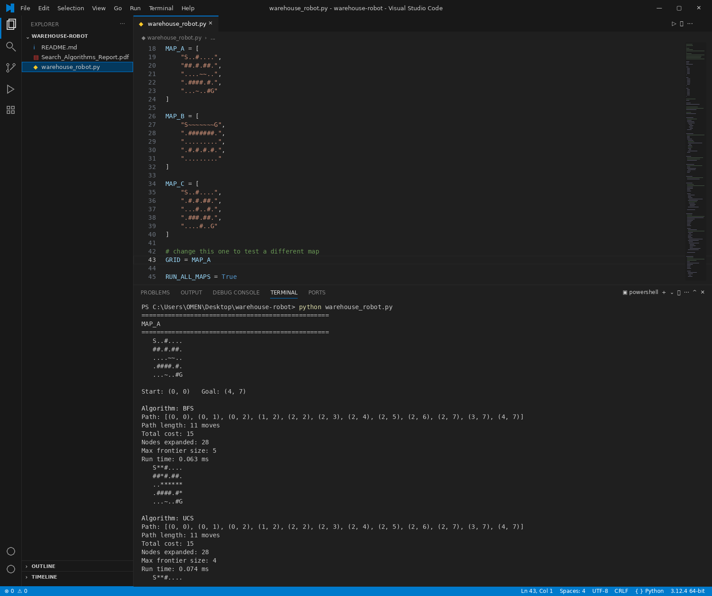
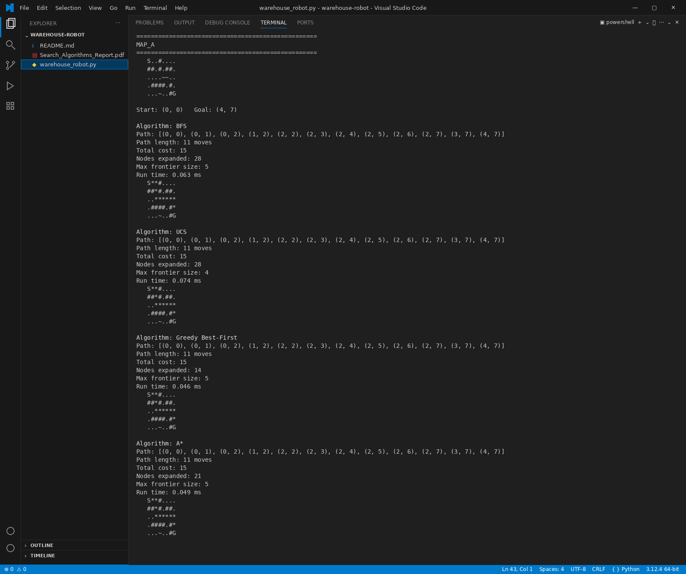
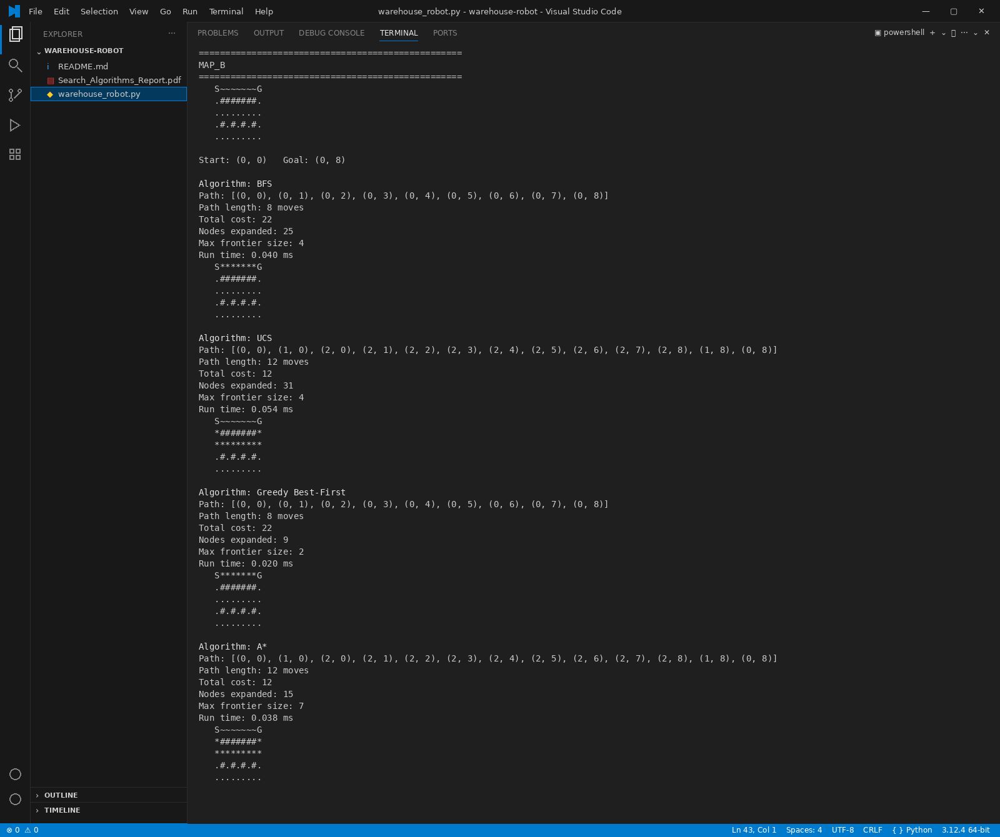
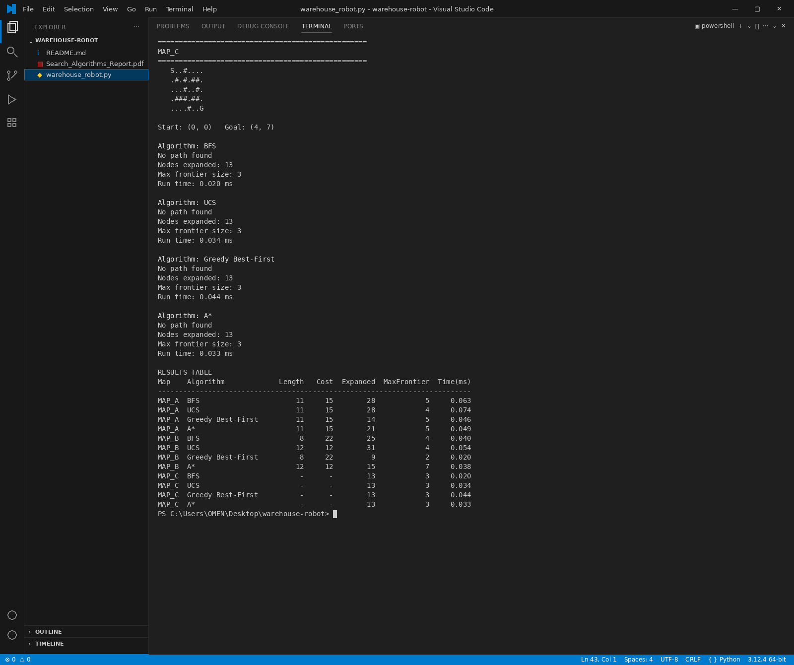

# Warehouse Delivery Robot – Search Algorithms

Intelligent Systems – Task 1

In this project there is a robot in a warehouse and it need to go from the start cell `S` to the goal cell `G` on a grid map. The robot can move up, down, left or right one cell in each time and it can not go through the walls. We find the path by using four search algorithms, we wrote all of them from scratch without any path-finding library:

- **BFS** (Breadth-First Search), uninformed
- **UCS** (Uniform Cost Search), uninformed
- **Greedy Best-First Search**, informed (using Manhattan distance)
- **A\*** Search, informed (using Manhattan distance)

## Team

| Name | ID |
| --- | --- |
| Muhammad Ahmed Sulaiman | 2403249505 |
| Eman Gamal Ahmed | 2403247543 |

## Map symbols

| Symbol | Meaning | Cost to enter |
| --- | --- | --- |
| `S` | Start cell | not counted |
| `G` | Goal cell | 1 |
| `.` | Normal floor | 1 |
| `~` | Rough floor | 3 |
| `#` | Wall | can't enter |

## How to run

You need only Python 3. All the things we used is from the standard library so you dont need to install anything.

```bash
python warehouse_robot.py
```

By default the program run the four algorithms on `MAP_A`, `MAP_B` and `MAP_C`. For every algorithm it print:

- the path as list of (row, column)
- the path length and the total cost
- number of nodes expanded
- the max frontier size and the run time
- the map with the path marked by `*`

In the end it print a results table with all of the results together. If there is no path it will print `No path found`.

## Changing the map

The maps are in the top of `warehouse_robot.py`. If you want to run only one map:

1. Make `RUN_ALL_MAPS = False`
2. Change `GRID = MAP_A` to `MAP_B`, `MAP_C`, or your own map

If you want to use your own map, add it like list of strings (every string is one row) and it must have only one `S` and one `G`:

```python
MY_MAP = [
    "S..~.",
    ".#.#.",
    "....G"
]

GRID = MY_MAP
```

## Results

| Map | Algorithm | Length | Cost | Nodes expanded | Max frontier |
| --- | --- | --- | --- | --- | --- |
| MAP_A | BFS | 11 | 15 | 28 | 5 |
| MAP_A | UCS | 11 | 15 | 28 | 4 |
| MAP_A | Greedy | 11 | 15 | 14 | 5 |
| MAP_A | A\* | 11 | 15 | 21 | 5 |
| MAP_B | BFS | 8 | 22 | 25 | 4 |
| MAP_B | UCS | 12 | 12 | 31 | 4 |
| MAP_B | Greedy | 8 | 22 | 9 | 2 |
| MAP_B | A\* | 12 | 12 | 15 | 7 |
| MAP_C | all four | No path found | – | 13 | 3 |

MAP_B is the trap map. BFS and Greedy is taking the shortest way directly on the rough floor and this cost 22. UCS and A\* goes around and they pay only 12. A\* find the same cheapest path but it expand around half of the nodes that UCS expand, because of this we choosed A\* for the robot.

## Files

| File | What is it |
| --- | --- |
| `warehouse_robot.py` | The source code |
| `Search_Algorithms_Report.pdf` | The full report (formulation, algorithms, heuristic, results, screenshots and comparison) |
| `README.md` | This file |

## Screenshots

### Running the code


### MAP_A output


### MAP_B output


### MAP_C output and results table

